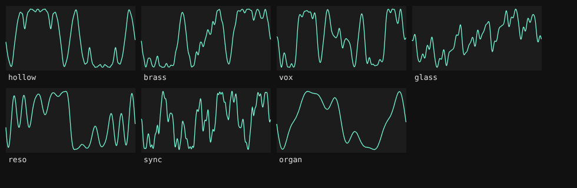

# ppg-chord: PPG wavetable for SY CHORD

This mod puts a **PPG-style wavetable** into SY CHORD's wave bank. Turning **WAVE** from 4 to 124 then sweeps through the table, and SY CHORD blends neighbouring frames, much as the PPG Wave scans its tables. You can p-lock WAVE or modulate it like any other machine parameter.

- **Replaces:** MAX's *SY CHORD Wave Bank*. It writes the same region, so you use one or the other (see [Builds](#builds)).
- **Unchanged:** WAVE 0 (a sine shared with other machines), every other machine, and the screen pictures. The small wave picture for WAVE still shows the stock shapes, by choice.
- **Cost:** data only, no code, no CPU load.
- **Existing sounds:** those that use SY CHORD with WAVE above 0 will sound different.

## How a PPG table becomes the bank

| PPG Wave | SY CHORD bank |
|---|---|
| 61 positions per wavetable; key waves at some positions, interpolated in between | 31 frames, WAVE 4, 8 … 124; SY CHORD interpolates in between |
| each wave: 64 8-bit samples per half cycle, mirrored and inverted to 128 | each frame: 256 samples + 1 guard sample, int32, peak `0x7FFF0000`, starting at 0 |

- **Positions:** positions 0, 2, … 60 become frames 1 … 31, which is exactly 31. Wavetables with a key wave at every second position (16, 26 and 27 in wave-stuff's data) keep every key wave.
- **Band limit:** each frame is band-limited, 40 harmonics by default, as in Workbench. `--harmonics` goes up to 63, the most a PPG wave has. SY CHORD uses the same frame for every note, so brighter means more aliasing on high notes.
- **Phase:** every PPG wave has odd symmetry around mid-cycle, so its band-limited version crosses zero exactly there. Each frame is rotated by that half cycle, so all frames start at a true 0 with the same phase. SY CHORD's blending between frames then never cancels out.
- **Polarity:** one polarity for the whole bank, decided by majority.

The bank layout comes from [syntakt-firmware-workbench](https://github.com/Bezronczek/syntakt-firmware-workbench) (Bezronczek, MIT), measured on hardware; see [docs/audio-path.md](../../docs/audio-path.md). The PPG format comes from [wave-stuff](https://github.com/Jacajack/wave-stuff).

## Sources

- **A PPG wavetable** (0–28) from your **local** copy of wave-stuff's `data/ppg_data.c`. Keep it in `local/` (git-ignored). A `patch.json` built from it contains data derived from that ROM.
- **A curated bank** (`--curated`): 31 single ROM waves instead of one table. The ROM holds 241 distinct waves for 31 frames, so a choice is made:
  - empty waves, duplicates and **basic shapes** are dropped. A wave counts as basic when its spectrum is ≥ 0.95 similar to a sine, saw, square, triangle or 6–38 % pulse; that's 55 of the 241, leaving 186.
  - the 31 most different from each other are kept;
  - they are ordered so that each wave resembles the next. The order starts from the darkest and roughly brightens; neighbour similarity rises from ~0.25 to ~0.6, so SY CHORD's blends between frames stay musical. `--order brightness` gives a strict dark → bright order instead.
- **Your own list** (`--ppg-waves 12,40,77,…`, up to 31). In the catalog, star ROM waves and press *Starred ROM waves → bank* to get the command. With fewer than 31, `--fill-max` completes the bank from MAX's SY CHORD bank: first its 21 non-basic waves (FM, formant, wavefold, sync, organ, chord waves…), then, only if still needed, its saws and pulses.
- **Our 7 designed waves** (`--designed`): hollow, brass, vox, glass, reso, sync, organ. They are spread over the table in order and interpolated. You can give your own order, for example `--designed vox glass reso`. These need no ROM, and the committed `patch.json` is this table.



## Use

```sh
python mods/ppg-chord/make_patch.py catalog --ppg-rom local/ppg_data.c    # out/ppg-chord/catalog.html
python mods/ppg-chord/make_patch.py preview --ppg-rom local/ppg_data.c --all   # one WAV per table: chord sweeping WAVE 4 -> 124
python mods/ppg-chord/make_patch.py preview --ppg-rom local/ppg_data.c --ppg-table 5 --hold 64
python mods/ppg-chord/make_patch.py build   --ppg-rom local/ppg_data.c --ppg-table 5    # writes patch.json
python mods/ppg-chord/make_patch.py build   --designed
python mods/ppg-chord/make_patch.py build   --ppg-rom local/ppg_data.c --curated
python mods/ppg-chord/make_patch.py build   --ppg-rom local/ppg_data.c --ppg-waves 12,40,77 --fill-max
```

`build` needs no firmware: the stock hash of the region is the one MAX's bank declares, and every build checks it again against your OS. With `firmware/Syntakt_OS1.41.syx` present, `build` also checks the stock bank right away. Add `--emu` to also render SY CHORD with the original engine, before and after.

**The catalog** is one local page with every wave:
- **Designed:** the 7 designed waves.
- **ROM waves:** the 256 ROM waves. Waves close to a basic shape are dimmed and labelled, and *hide basic shapes* removes them. Stars feed *Starred ROM waves → bank*.
- **Curated bank:** the 31 waves `--curated` picks, in bank order, with **▶ sweep**.
- **Wavetables:** the 29 tables. Each has a **▶ sweep** button that plays WAVE 4 → 124, and the slots that become frames are labelled W4 … W124.

The footer shows the `build` command for the table you picked. ★ shortlists a wave in your browser. The page contains ROM data from your local file and is written to `out/`.

## Builds

**Linux / WSL** (`tools/build/build.py`): MAX's features are available as `max:<name>`. To build the MAX set with the PPG wavetable instead of MAX's bank:

```sh
python tools/build/build.py --stock firmware/Syntakt_OS1.41.syx \
    max:splash max:dual-mono max:modarea max:vparams max:master-comp max:readable-values \
    max:beat-repeat max:fx3 max:deja-vu mods/ppg-chord -o out/max-ppg.syx
```

Add `max:fm4` for SY FM4. `ppg-chord` together with `max:sy-chord` is refused, both through `"conflicts"` and through the overlap check.

**Windows modular builder** (`tools/max/modular_builder`): under *Local patch* choose `mods/ppg-chord/patch.json` and untick *SY CHORD Wave Bank*. The builder refuses to combine the two. A build with a local patch is reported as profile `CUSTOM + ppg-chord` and has no pinned "golden" hash. The packaged `.exe` has to be rebuilt from source (`build_windows.ps1`) to get this option.

## Status

- ✅ Bank layout, frame format, conditioning, patch, and compatibility with MAX's manifest: `tests/test_ppg_chord.py`. It checks that MAX's bank occupies the same region, has the same stock hash and uses the same frame format. These run without firmware.
- ✅ All 29 real wave-stuff tables convert (checked locally).
- ⬜ Emulator tests with the stock OS: skipped until it is in `firmware/`.
- ⬜ Windows GUI change: syntax-checked only, not run.
- ⬜ Not yet tried on hardware.
