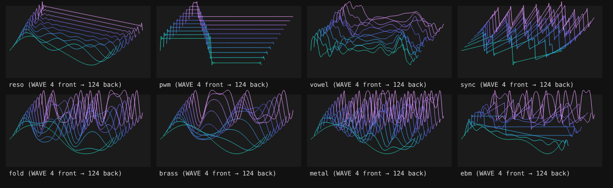

# ppg-chord: PPG-style wavetables for SY CHORD

Puts **PPG-style wavetables** into SY CHORD's wave bank. Turning **WAVE** from 4 to 124 sweeps through the table, and SY CHORD blends neighbouring frames, the way a PPG Wave scans its tables. You can p-lock WAVE or modulate it like any other machine parameter.

| | |
|---|---|
| **Default bank** | `ebm`: zones designed for synth-pop / EBM (see [Banks](#banks)) |
| **Changes** | SY CHORD's 31 frames at WAVE 4, 8 … 124: data only, no code, no CPU load |
| **Unchanged** | WAVE 0 (a sine shared with other machines), every other machine, the screen pictures (they still show the stock shapes) |
| **Replaces** | MAX's *SY CHORD Wave Bank*: same region, so a build uses one or the other |
| **Existing sounds** | those using SY CHORD with WAVE above 0 sound different |
| **Status** | ✅ verified on hardware (`ebm` and `ebm7` banks, Syntakt OS 1.41) |

Building and flashing the firmware: see the [main README](../../README.md#build-and-install-this-fork).

## Quick start

```sh
python mods/ppg-chord/make_patch.py preview --table all --ebm      # listen first: WAVs in out/ppg-chord/preview
python mods/ppg-chord/make_patch.py build --table ebm              # writes patch.json (this is the committed default)
```

Then build the firmware with `mods/ppg-chord` in the mod list, and check the result with `make_patch.py check <file.syx>` before flashing.

## Banks

One bank per firmware. Pick it with `build`:

| Source | Option | Needs the PPG data |
|---|---|---|
| Designed tables (default `ebm`) | `--table ebm`, `reso`, `pwm`, `vowel`, `sync`, `fold`, `brass`, `metal` | no |
| A PPG ROM wavetable | `--ppg-rom local/ppg_data.c --ppg-table 0..28` | yes |
| 31 curated PPG waves | `--ppg-rom local/ppg_data.c --curated` | yes |
| Your own PPG waves | `--ppg-rom local/ppg_data.c --ppg-waves 12,40,77,… [--fill-max]` | yes |
| Our 7 single waves, interpolated | `--designed [names…]` | no |
| **Zone bank** mixing our families and PPG tables | `--zones ebm7 --ppg-rom local/ppg_data.c`, or your own spec | only for `ppgN` zones |

### Designed tables



Our own tables, generated in `tables.py`. Each is a smooth 31-frame morph.

| Table | Morph (WAVE 4 → 124) | For |
|---|---|---|
| `reso` | saw through a resonant low-pass that opens | EBM bass and leads, the PPG "sweep" |
| `pwm` | pulse 50 % → 5 % | PWM pads and basses |
| `vowel` | vowels A → E → I → O → U | digital choirs; clearest with unison |
| `sync` | hard sync, ratio 1 → 8, with some master saw | aggressive leads |
| `fold` | wavefolder, gain 1 → 12 | rough digital tones |
| `brass` | FM 1:1, index 0 → 7 | digital brass that opens up |
| `metal` | FM 1:3, index 0 → 6 | bells, metallic hits |
| **`ebm`** | **zones:** reso 4–28 · pwm 32–52 · vowel 56–80 · sync 84–104 · metal 108–124 | variety in one bank (default) |

In `ebm`, only the vowel zone sounds like vowels. The other zones keep their character without "talking" (see [How it works](#how-it-works)).

### Zone banks

A zone bank puts several small tables into the 31 frames: WAVE picks the zone, and an LFO with a small depth sweeps inside it. `--zones` takes a preset or a list of `name:frames[:flatten]`. The name is one of our families or `ppgN` (PPG wavetable N), and the frames must add up to 31.

| Preset | Zones (WAVE) | Needs |
|---|---|---|
| `ebm` | reso 4–28 · pwm 32–52 · vowel 56–80 · sync 84–104 · metal 108–124 | nothing (same as `--table ebm`) |
| `ebm7` | reso 4–20 · pwm 24–36 · vowel 40–56 · sync 60–72 · **PPG 23** 76–92 · **PPG 26** 96–108 · **PPG 14** 112–124 | `--ppg-rom` |

- **Processing:** PPG zones go through the same steps as our tables (louder phases, phase-continuous alignment, at most 63 harmonics). Their formant bumps are flattened by 0.4 by default; `ebm7` uses 0.6 for PPG 14, which talks more.
- **Measured for `ebm7`:**
  - all zones between −2.2 and −3.4 dBFS, so switching zones doesn't jump in level;
  - only the vowel zone talks (16 dB; the others 4–10 dB);
  - in the 5-frame vowel zone each frame is a different vowel, so a blend between two vowels dips about 2 dB.
- **Your own spec**, for example: `--zones reso:6,pwm:5,vowel:7,ppg23:7,ppg26:6`.

### PPG ROM sources

These read your **local** copy of [wave-stuff](https://github.com/Jacajack/wave-stuff)'s `data/ppg_data.c`. Keep it in `local/`, which is git-ignored. A `patch.json` built from it contains data derived from the PPG ROM, so keep that file private.

- **`--ppg-table T`** uses one of the 29 PPG wavetables. A table has 61 positions; the even ones (0, 2 … 60) become the 31 frames.
- **`--curated`** picks 31 single waves out of 241. Empty waves, duplicates and basic shapes (sine, saw, square, triangle, pulse) are dropped, and so are sparse organ-like waves (fewer than 15 strong harmonics) and thin waves (less than 30 % of the energy in harmonics 1–3). The 31 most different waves are kept and ordered so each resembles the next.
- **`--ppg-waves`** uses your own list of up to 31 waves. In the catalog, star waves and press *Starred ROM waves → bank*. With fewer than 31, `--fill-max` completes the bank from MAX's waves, non-basic ones first.
- **`--grit`** reads the 8-bit PPG waves "in steps", as the PPG did, which adds a little digital sparkle above the 63rd harmonic.

## Playing it

SY CHORD **never moves through the bank by itself**: at a fixed WAVE it reads the same frames for the whole note. This was measured in the original engine. On a PPG Wave the movement comes from modulating the wavetable position, mainly with an envelope on every note. On the Syntakt, use the SY CHORD track's LFO:

| Goal | LFO setting |
|---|---|
| PPG-style sweep on each note | DEST = WAVE, MODE = ONE (runs once per trig), ramp or exponential shape; depth sets how far, speed how fast |
| Continuous cycling while the note holds | DEST = WAVE, MODE = TRG or FREE, triangle or sine |
| A different wave on every note | DEST = WAVE with Déjà Vu DV-T, or p-locks on WAVE |

With `ebm`, choose a zone with WAVE and sweep inside it with a small depth: for example WAVE 4 with depth 24 for a filter-like bass on every note.

### Is the new bank on the device?

Compare **WAVE 52** with **WAVE 0**, which is always the stock sine. Use one note (unison), filter open, nothing modulating WAVE:

| Bank on the device | WAVE 52 | WAVE 124 |
|---|---|---|
| stock | a pure sine, like WAVE 0 | sine-like |
| MAX | Organ 1-2-4 | a major-9 chord in one note |
| ppg-chord `ebm` | a thin, buzzy pulse | metallic FM |
| ppg-chord `ebm7` | a vowel (vowel zone) | PPG wave (zone PPG 14) |

## Commands

| Command | What it does | Needs firmware |
|---|---|---|
| `build <source>` | writes `patch.json` for the chosen bank and prints its zones or waves | no (with `firmware/Syntakt_OS1.41.syx` present it also checks the stock bank) |
| `build <source> --emu` | also renders SY CHORD in the original engine, stock and new bank | yes |
| `preview <source>` | WAV of a chord sweeping WAVE 4 → 124; `--hold W` for a fixed WAVE; `--ebm` for a 16th-note bass line with one sweep per note; `--table all` or `--all` for every table | no |
| `catalog [--ppg-rom …]` | `out/ppg-chord/catalog.html`: every wave and table, playable in the browser, with the `build` command for each | no |
| `check <file.syx>` | tells which SY CHORD bank a firmware file contains: stock, MAX, your `patch.json`, or another | no |
| `list` | the 7 designed single waves | no |

Useful options:
- `--harmonics N` sets the band limit. Defaults: 64 for designed tables, 40 for PPG waves, 127 with `--grit`. Higher is brighter, but one frame serves every note, so high notes alias.
- `--keep-phase` keeps the designed tables' original waveforms instead of the louder ones.
- `--order brightness` orders a curated bank dark → bright instead of by similarity.
- `--min-body` and `--min-density` adjust the curated selection.

## How it works

**The bank.** SY CHORD reads 32 frames. Frame 0, the shared sine at WAVE 0, is never touched. Frames 1–31 are 256 samples plus 1 guard sample, int32, peak `0x7FFF0000`, starting at 0, stored in reverse order at `0x40016B80–0x4001E7FC`. The layout comes from [syntakt-firmware-workbench](https://github.com/Bezronczek/syntakt-firmware-workbench) (Bezronczek, MIT), where it was measured on hardware; see [docs/audio-path.md](../../docs/audio-path.md). The patch covers exactly the same bytes as MAX's bank, with the same stock hash, so the build refuses to combine the two.

**Each frame** is band-limited and starts on a true rising zero, as the stock frames do. Neighbouring frames are kept in phase, so SY CHORD's blend between them never cancels. For the designed tables, the starting points of all 31 frames are chosen together to maximise similarity along the table.

**Loudness.** Every frame is at full peak, like the stock frames, so the level depends on how peaky the waveform is. The designed tables keep each frame's exact harmonic levels (same timbre) but choose the phases for a low peak, while staying continuous with the neighbouring frame:
- `ebm` frames: median −3.0 dBFS against −7.0 with the original waveforms, about 2 dB above the stock bank;
- in the original engine, a SY CHORD chord gains up to +3.8 dB, but less at the attack, where partials shared by two chord notes partly cancel.

**Only the vowel zone talks.** A moving bump in the spectrum sounds like a vowel. In `ebm`, the bumps of `reso` (resonance), `sync` (sync peak) and `metal` (FM sidebands) are flattened toward the smooth spectrum:
- `reso`: 16.7 → 6.5 dB above the trend;
- `sync`: 12.5 → 5.0 dB;
- `metal`: 22.2 → 11.1 dB (halved, to keep the bells);
- `vowel`: stays at 16 dB.

The standalone `reso`, `sync` and `metal` tables keep their talking character.

**PPG data.** A PPG wave is 64 8-bit samples per half cycle; the second half is the first one reversed and inverted. The odd symmetry means the band-limited wave crosses zero exactly at mid-cycle. Each frame is rotated there, which gives every PPG frame a true zero start and the same phase.

### Lessons from the hardware tests

- **Thin waves sound short.** Waves with almost no fundamental sounded short and quiet, because a closing low-pass filter removes almost all of them. That led to the body rule for curated banks.
- **Sparse waves sound like an organ.** A drawbar organ has 4–8 strong harmonics; the first curated banks had a median of 6–9. Synth-pop and EBM timbres are dense: saw, pulse, resonance, sync, formants. That led to the density rule and to the designed tables.
- **Moving bumps sound like vowels.** In the first `ebm` bank, vowels seemed to come round in every zone. That led to flattening outside the vowel zone.

## Status

- ✅ **Hardware:** verified on a Syntakt (OS 1.41, MAX + FM4 base) with the `ebm` bank and the `ebm7` zone bank: boots, the waves sweep, normal envelopes, good level.
- ✅ `tests/test_ppg_chord.py`: bank layout and format, compatibility with MAX's manifest, the tables' continuity and loudness, the PPG parsers, the curated selection, and the command line. With the stock OS in `firmware/`, it also plays the bank in the original engine (emulator).
- ⬜ Windows modular builder: the *Local patch* option is in the source, but the packaged `.exe` must be rebuilt (`build_windows.ps1`), and the GUI has not been run.
